# Design — Thesis-project (fase A)

Documento de diseño de thesis-project: rampa de color, tokens semánticos, puente 3D,
tipografía, espaciado, capas, radios, accesibilidad y guías de uso. La **única fuente de
verdad del color en el código** es `src/styles/variables.css`; este documento la describe.

## Modelo de 3 capas

El color del planetario se organiza en 3 capas obligatorias:

1. **Rampa** (`--paso-50` … `--paso-950`): 11 escalones genéricos, **por perfil**. Definida
   en `src/styles/variables.css` dentro de `:root, [data-perfil='azul'] { … }`. En fase A
   cada paso vale el hex que ya estaba vivo (perfil azul).
2. **Tokens semánticos** (fijos): `--fondo`, `--texto`, `--acento`, `--boton`, `--reticula`,
   `--negro`, `--blanco`, etc. Casi todos son `var(--paso-N)`; unos pocos son literales
   fijos (neutros, divergencias históricas, tripletas rgb). **No cambian entre perfiles**
   (solo cambia su `--paso-*` de origen).
3. **Consumidores**: los CSS (`src/styles/*.css`), los estilos inline de JS (`src/ui/*.js`,
   `src/reticula/etiquetas.js`) y la escena 3D (vía `src/escena/paleta.js`). **Los
   consumidores jamás escriben un hex/rgb crudo**: usan `var(--token)` o se suscriben al token con `suscribirColor`.

`src/styles/variables.css` es la única fuente de verdad del color y
`src/escena/paleta.js` es el puente que lleva esos tokens a three.js.

## Rampas por perfil

11 escalones (estilo Tailwind, 50…950). El valor de cada paso **define** el perfil activo:
cada perfil redefinió la rampa completa en su bloque `:root[data-perfil='…']` (especificidad
(0,2,0), gana al `:root`). El perfil **azul** (default) conserva la fase A byte-idéntica
(fase B — uniformar hue a H=210 y unificar divergencias históricas — pendiente de decisión);
los perfiles **rojo** y **morado** los añadió con la misma curva S/L por rol,
calibrados hue a hue. Los cuadritos son swatches SVG (uno por escalón, junto al valor
hexadecimal).

### Azul (default, H=210 actual)

| Paso         | Valor     | Muestra                                                                  | Rol                  |
| ------------ | --------- | ------------------------------------------------------------------------ | -------------------- |
| `--paso-50`  | `#e8f2ff` |   | texto principal      |
| `--paso-100` | `#cfe8ff` |  | texto tooltip        |
| `--paso-200` | `#9fc4e8` | 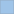 | texto secundario     |
| `--paso-300` | `#7fb8ff` |  | acento y foco        |
| `--paso-400` | `#5bb6e8` | 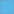 | etiquetas 3D         |
| `--paso-500` | `#2a6cae` |  | botón hover          |
| `--paso-600` | `#2f6f9f` |  | retícula 3D          |
| `--paso-700` | `#1d4f80` |  | botón                |
| `--paso-800` | `#224466` |  | eje del grid         |
| `--paso-900` | `#112233` |  | líneas del grid      |
| `--paso-950` | `#0b1420` | 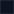 | fondo de superficies |

### Rojo (H=6)

| Paso         | Valor     | Muestra                                                                  | Rol                  |
| ------------ | --------- | ------------------------------------------------------------------------ | -------------------- |
| `--paso-50`  | `#ffeae8` | 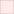  | texto principal      |
| `--paso-100` | `#ffd4cf` | 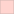 | texto tooltip        |
| `--paso-200` | `#e8a69f` | 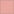 | texto secundario     |
| `--paso-300` | `#ff8c7f` | 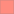 | acento y foco        |
| `--paso-400` | `#e8695b` |  | etiquetas 3D         |
| `--paso-500` | `#ae372a` |  | botón hover          |
| `--paso-600` | `#9f3a2f` |  | retícula 3D          |
| `--paso-700` | `#80271d` |  | botón                |
| `--paso-800` | `#662922` |  | eje del grid         |
| `--paso-900` | `#331411` | 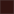 | líneas del grid      |
| `--paso-950` | `#200d0b` |  | fondo de superficies |

### Morado (H=275)

| Paso         | Valor     | Muestra                                                                    | Rol                                                                            |
| ------------ | --------- | -------------------------------------------------------------------------- | ------------------------------------------------------------------------------ |
| `--paso-50`  | `#f5e8ff` |   | texto principal                                                                |
| `--paso-100` | `#ebcfff` | 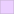 | texto tooltip                                                                  |
| `--paso-200` | `#ca9fe8` | 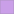 | texto secundario                                                               |
| `--paso-300` | `#ca7fff` |  | acento y foco                                                                  |
| `--paso-400` | `#ad5be8` | 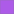 | etiquetas 3D                                                                   |
| `--paso-500` | `#772aae` | 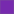 | botón hover                                                                    |
| `--paso-600` | `#812ebd` |  | retícula 3D (ajustada a L46: retícula ≥3:1 vs cielo; sin ajustar quedaría 2.6) |
| `--paso-700` | `#571d80` |  | botón                                                                          |
| `--paso-800` | `#4a2266` |  | eje del grid                                                                   |
| `--paso-900` | `#251133` | 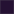 | líneas del grid                                                                |
| `--paso-950` | `#170b20` |  | fondo de superficies                                                           |

## Tokens semánticos

Token → valor fase A → rol → contraste vs `--fondo` (#0b1420) cuando aplica:

| Token                 | Valor fase A                | Rol / uso                                                                  |
| --------------------- | --------------------------- | -------------------------------------------------------------------------- |
| `--fondo`             | `var(--paso-950)` (#0b1420) | paneles, tarjetas, píldoras, input, listas                                 |
| `--fondo-translucido` | `rgba(10, 20, 40, 0.92)`    | tooltip (divergencia histórica: #0a1428 ≠ #0b1420, fase B)                 |
| `--texto`             | `var(--paso-50)` (#e8f2ff)  | texto principal — 16.4 AAA vs `--fondo`                                    |
| `--texto-claro`       | `var(--paso-100)` (#cfe8ff) | texto del tooltip — 14.7 AAA                                               |
| `--texto-secundario`  | `var(--paso-200)` (#9fc4e8) | placeholder, lupa, filas secundarias — 10.2 AAA                            |
| `--acento`            | `var(--paso-300)` (#7fb8ff) | acento sólido, focos, `accent-color` — 9.0 AAA                             |
| `--acento-rgb`        | `120, 180, 255`             | tripletas de alfa (divergencia histórica: #7fb8ff = 127,184,255; fase B)   |
| `--boton`             | `var(--paso-700)` (#1d4f80) | fondo de botones — `--blanco`/`--boton` 8.5 AAA                            |
| `--boton-rgb`         | `29, 79, 128`               | alfa del hover de la lista (= #1d4f80 exacto)                              |
| `--boton-hover`       | `var(--paso-500)` (#2a6cae) | hover/activo de botones — `--blanco`/`--boton-hover` 5.5 AA                |
| `--etiqueta-3d`       | `var(--paso-400)` (#5bb6e8) | etiquetas CSS2D — 9.3 AAA vs cielo #000                                    |
| `--reticula`          | `var(--paso-600)` (#2f6f9f) | línea punteada de la esfera celeste — 3.9 UI (≥3)                          |
| `--resaltado`         | `#ff2b2b`                   | punto de hover/selección en 3D — 5.6 AA vs cielo #000                      |
| `--error-rgb`         | `120, 0, 0`                 | banner de aviso accesible — `--blanco`/aviso 11.7 AAA                      |
| `--negro`             | `#000000`                   | fondo raíz y cielo 3D (fijo en todos los perfiles)                         |
| `--negro-rgb`         | `0, 0, 0`                   | overlays (`rgba(var(--negro-rgb), α)`)                                     |
| `--blanco`            | `#ffffff`                   | texto invertido sobre superficies saturadas (fijo) — 18.5 AAA vs `--fondo` |
| `--gris`              | `#333333`                   | borde del badge de stats (fijo)                                            |

## Tokens 3D y puente three.js

`src/escena/paleta.js` es el puente que lleva los tokens a three.js (motor
unificado a una sola lista de aplicaciones). Exporta:

- `suscribirColor(aplicar, nombre)`: lee el token desde CSS con
  `getComputedStyle(document.documentElement).getPropertyValue(nombre).trim()`, aplica el
  valor inicial de forma síncrona (todas las suscripciones se registran durante
  `iniciar()`, antes del primer frame: sin flash de colores por defecto) y deja registrada
  la re-aplicación para el cambio de perfil en vivo.
- `aplicarPaleta()`: re-ejecuta todas las aplicaciones registradas; la invoca el selector
  de perfiles vía el callback `alCambiarPerfil` inyectado desde `main.js` (`src/ui/perfiles.js`
  muta `data-perfil` en `<html>` ANTES de avisar, para que `getComputedStyle` lea el perfil
  nuevo).

Si el CSS no estuviera cargado, los fallbacks `RESPALDOS` (los 3 literales de fase A:
`--negro` `#000000`, `--resaltado` `#ff2b2b`, `--reticula` `#2f6f9f`) mantienen la escena
idéntica: doble seguridad de "cero cambio visual".

Semántica única: los materiales de three **copian** el Color que reciben en su
constructor (y `setClearColor` también copia), así que toda aplicación va por callback
re-ejecutado que relee el token. Funciona igual para copias (`material.color`) y para
referencias (`scene.background`, cuyo callback muta la MISMA instancia que la escena
retiene).

Consumidores del puente: **5 suscripciones en 5 archivos** (más `main.js`, que solo importa
`aplicarPaleta`): `src/escena/escena.js` (fondo de la escena, `--negro`),
`src/escena/renderer.js` (clear color, `--negro`: registro ÚNICO, en quien posee el
renderer), `src/interaccion/interaccion.js` (resaltado de hover, `--resaltado`),
`src/reticula/esferaCeleste.js` (retícula, `--reticula`) y `src/escena/marcador.js`
(anillo de selección, `--acento`). Hoy solo `--reticula` y `--acento` cambian entre
perfiles; `--negro` y `--resaltado` son fijos (si un perfil futuro los cambiara, también
se repintarían en vivo). `src/reticula/ejes.js` (renombrado desde `grid.js`) solo exporta `crearAxes()` y ya no consume el puente. `src/reticula/etiquetas.js` es
CSS2D: usa color CSS (`span.style.color = 'var(--etiqueta-3d)'`), no el puente. Los
estilos inline de `src/ui/avisos.js` y `src/ui/stats.js` también usan `var()` (hereda de
`:root`).

## Neutros y excepciones fijas

- **Neutros no themables** en todos los perfiles: cielo `--negro` (#000000), luces blancas
  `0xffffff` (`src/escena/luces.js`: cambiarlas teñiría las estrellas), texto invertido
  `--blanco` (#ffffff), overlays con `--negro-rgb`, `--gris` (#333333) solo para el borde
  del badge de stats. Se tokenizan para que el grep de literales sea limpio.
- **Paleta de estrellas por vmag** (`setHSL` en `src/estrellas/estrellas.js`): codifica
  datos, **no es themable**.
- **`src/estrellas/estrella.js`**: archivo huérfano (backlog 002), su `0xffffff` queda
  intacto.
- **`AxesHelper`** de `src/reticula/ejes.js` (renombrado desde `grid.js`):
  usa los colores rojo/verde/azul canónicos de three.js (sin literales propios).
- **Comentarios históricos verbatim**: `src/styles/inspector.css:14`
  (`rgba(0, 0, 0, 0.6)` dentro de un comentario) y `src/reticula/etiquetas.js:42`
  (`#2A81AD` dentro de un comentario) se conservan tal cual.
- **`transparent` / `currentColor`**: keywords, no literales de color.

## Contraste AA/AAA (pares reales en uso)

| Par                                              | CR   | Nivel   |
| ------------------------------------------------ | ---- | ------- |
| `--texto` #e8f2ff / `--fondo` #0b1420            | 16.4 | AAA     |
| `--texto-claro` #cfe8ff / `--fondo`              | 14.7 | AAA     |
| `--texto-secundario` #9fc4e8 / `--fondo`         | 10.2 | AAA     |
| `--acento` #7fb8ff / `--fondo`                   | 9.0  | AAA     |
| `--blanco` / `--fondo`                           | 18.5 | AAA     |
| `--etiqueta-3d` #5BB6E8 / cielo #000             | 9.3  | AAA     |
| `--blanco` / `--boton` #1d4f80                   | 8.5  | AAA     |
| `--blanco` / `--boton-hover` #2a6cae             | 5.5  | AA      |
| `--texto` / `--boton`                            | 7.5  | AAA     |
| `--texto` / `--boton-hover`                      | 4.8  | AA      |
| `--texto-secundario` / `--boton` (fila activa)   | 4.7  | AA      |
| `--blanco` / aviso `rgba(120,0,0,.92)` ≈ #780000 | 11.7 | AAA     |
| `--resaltado` #ff2b2b / cielo #000               | 5.6  | AA      |
| `--reticula` #2f6f9f / cielo #000                | 3.9  | UI (≥3) |

### Contraste del perfil rojo (H=6)

| Par                                            | CR   | Nivel   |
| ---------------------------------------------- | ---- | ------- |
| `--texto` #ffeae8 / `--fondo` #200d0b          | 16.2 | AAA     |
| `--texto-claro` #ffd4cf / `--fondo`            | 13.9 | AAA     |
| `--texto-secundario` #e8a69f / `--fondo`       | 9.2  | AAA     |
| `--acento` #ff8c7f / `--fondo`                 | 8.3  | AAA     |
| `--blanco` / `--fondo`                         | 18.7 | AAA     |
| `--etiqueta-3d` #e8695b / cielo #000           | 6.6  | AAA     |
| `--blanco` / `--boton` #80271d                 | 9.4  | AAA     |
| `--blanco` / `--boton-hover` #ae372a           | 6.2  | AA      |
| `--texto` / `--boton`                          | 8.2  | AAA     |
| `--texto` / `--boton-hover`                    | 5.4  | AA      |
| `--texto-secundario` / `--boton` (fila activa) | 4.7  | AA      |
| `--reticula` #9f3a2f / cielo #000              | 3.1  | UI (≥3) |
| `--resaltado` #ff2b2b / cielo #000 (fijo)      | 5.6  | AA      |

### Contraste del perfil morado (H=275)

| Par                                            | CR   | Nivel                                                        |
| ---------------------------------------------- | ---- | ------------------------------------------------------------ |
| `--texto` #f5e8ff / `--fondo` #170b20          | 16.2 | AAA                                                          |
| `--texto-claro` #ebcfff / `--fondo`            | 13.5 | AAA                                                          |
| `--texto-secundario` #ca9fe8 / `--fondo`       | 8.7  | AAA                                                          |
| `--acento` #ca7fff / `--fondo`                 | 7.2  | AAA                                                          |
| `--blanco` / `--fondo`                         | 19.0 | AAA                                                          |
| `--etiqueta-3d` #ad5be8 / cielo #000           | 5.4  | AAA                                                          |
| `--blanco` / `--boton` #571d80                 | 11.1 | AAA                                                          |
| `--blanco` / `--boton-hover` #772aae           | 7.7  | AAA                                                          |
| `--texto` / `--boton`                          | 9.4  | AAA                                                          |
| `--texto` / `--boton-hover`                    | 6.6  | AAA                                                          |
| `--texto-secundario` / `--boton` (fila activa) | 5.1  | AA                                                           |
| `--reticula` #812ebd / cielo #000              | 3.1  | UI (≥3) — con `--paso-600` ajustada a L46 (sin ajustar: 2.6) |
| `--resaltado` #ff2b2b / cielo #000 (fijo)      | 5.6  | AA                                                           |

## Tipografía

- **UI**: `system-ui, sans-serif`, tamaños 12–22 px (12 tooltip, 13 monoespaciada de datos,
  14 cuerpo, 18 títulos, 22 disparador de ayuda).
- **Datos**: `ui-monospace, SFMono-Regular, Menlo, monospace` a 13 px (tabla del inspector y
  filas del buscador).

## Espaciado

- Escala: 2 / 4 / 6 / 8 / 12 / 16 / 18 px.
- Gaps frecuentes: 4 px (controles) y 8 px (filas/acciones).
- **Área táctil ≥ 44×44 px** en todo control interactivo (botones ×/−/+, lupa, limpiar,
  puntos del tour, disparador, input, filas de la lista, círculos del selector de perfiles).

## Radios y z-index

- **Radios**: 4 px (botones), 8 px (tarjetas/listas), 999 px (píldoras) y 50 % (círculos).
- **z-index**: 20 tooltip, 21 stats, 25 inspector, 26 selector de perfiles, 30 aviso,
  40 ayuda.

## Accesibilidad

- **AA 4.5:1** para texto; **3:1** para UI y foco.
- Foco visible con `:focus-visible` (outline de acento) en todos los controles.
- Nunca información solo por color (p. ej. la fila activa del buscador también se marca con
  teclado; los destacados del inspector usan negrita selectiva).
- Canvas con `aria-label` ("Vista 3D del planetario").
- Respeta `prefers-reduced-motion` en las transiciones de la interfaz.

## Iconos SVG inline

- `src/ui/iconos.js` (módulo DOM puro, sin three ni datos) exporta `crearLupa()` y
  `crearCruz({ clase = 'icono-cruz', tamano = 14 } = {})`: SVG inline con
  `stroke: currentColor` (heredan la tinta del contenedor) y `aria-hidden` (el botón se
  nombra solo con `aria-label`).
- Consumidores: buscador (lupa + × de limpiar), inspector y ayuda (× de cierre,
  `{ clase: 'inspector-cruz'/'ayuda-cruz', tamano: 18 }`, centrado con flex en el botón
  de 44 px). El botón ícono deja de depender de glifos tipográficos.

## Do / Don't

- **Do**: definir el color nuevo en `src/styles/variables.css` (rampa o token) y consumirlo
  con `var(--token)` / `suscribirColor(..., '--token')`.
- **Don't**: escribir hex/rgb crudo fuera de `variables.css` y de los fallbacks de
  `paleta.js`.
- **Don't**: tokenizar ni themable-izar la paleta de estrellas por vmag (codifica datos),
  las luces blancas de `luces.js` ni el cielo negro.
- **Don't**: perfiles amarillo (H=50) y verde (H=150): diferidos porque su `--boton` claro
  con texto blanco queda en CR 2.9; rosa queda como extensión trivial futura.
- **Don't**: el selector no persiste; no añadir `localStorage` sin decisión explícita.

## Perfiles

Selector de perfiles: un `role="radiogroup"` colapsado en la esquina
inferior-izquierda (`left: 12px; bottom: 72px`, z-index 26, círculos con área táctil
≥ 44 px) cambia el atributo `data-perfil` de `<html>` en vivo —incluida la escena 3D—
sin recrear la escena.

- **Azul** (default, `data-perfil="azul"`): perfil de arranque (valor de `index.html`);
  sus valores siguen siendo la fase A byte-idéntica.
- **Rojo (H=6)** y **morado/violeta (H=275)**: **implementados**
  (redefinen los mismos 11 `--paso-*` más `--fondo-translucido`, `--acento-rgb` y
  `--boton-rgb` por perfil; los tokens semánticos restantes no cambian).
- **Amarillo (H=50)** y **verde (H=150)**: **diferidos** (su `--boton` claro con texto
  blanco quedaría en CR 2.9); rosa: extensión trivial futura (añadir bloque + muestra).
- **Sin persistencia**: nada de `localStorage` ni de `dataset.perfil` persistido; el
  atributo solo se muta en runtime y **al recargar la página se vuelve al azul**. La
  persistencia está **deshabilitada a propósito** (regla histórica del proyecto).
- **Muestras del selector**: los tokens fijos `--muestra-azul` (#7fb8ff),
  `--muestra-rojo` (#ff8c7f) y `--muestra-morado` (#ca7fff) colorean los círculos del
  disparador y de cada radio. Son **tokens de muestra** (no themables, no son tokens
  semánticos de la capa 2): su única fuente de verdad es `variables.css` y ningún CSS
  de consumidor debe escribir esos hex sueltos.
